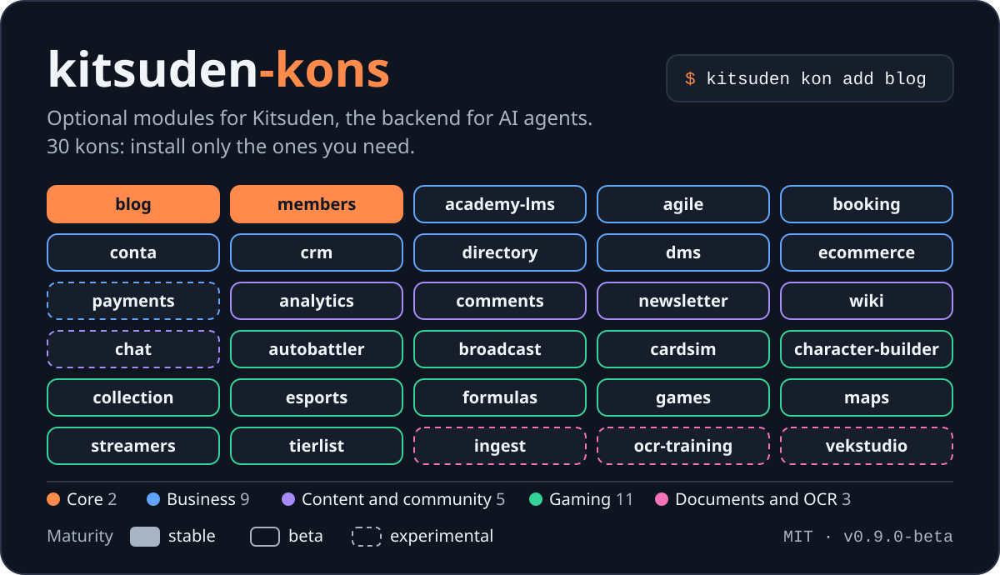
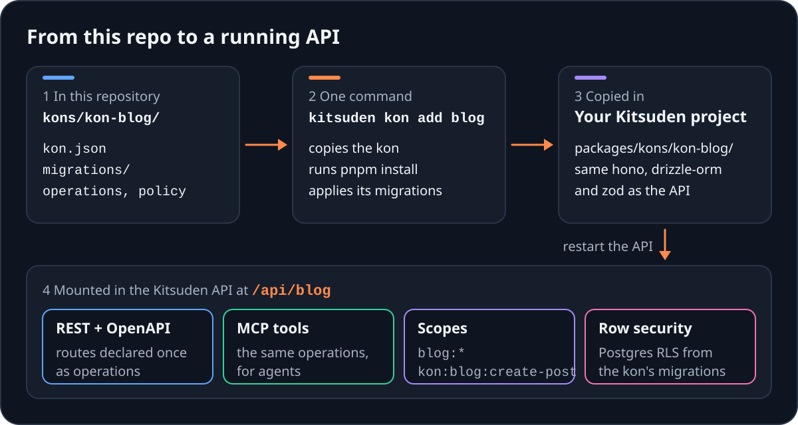

<p align="center">
  
</p>

<p align="center">
  <a href="https://github.com/Kitsuden/kitsuden-kons/actions/workflows/ci.yml"></a>
  
  <a href="LICENSE"></a>
</p>

# kitsuden-kons

**Add a blog, a CRM or payments to your backend with one command.** Kons are optional modules
for [Kitsuden](https://github.com/Kitsuden/kitsuden), the backend for apps that AI agents use.
Each kon brings its tables, API routes, MCP tools and permissions; you install the ones you
need and the rest never touch your project.

<p align="center">
  
</p>

## Quick start

You need a Kitsuden checkout ([install it first](https://github.com/Kitsuden/kitsuden#quickstart))
and this repository cloned next to it. The CLI is not on npm yet, so it runs from the Kitsuden
repository as `pnpm kitsuden`:

```bash
# in your Kitsuden folder
git clone https://github.com/Kitsuden/kitsuden-kons.git ../kitsuden-kons
pnpm --filter @kitsuden/cli build                            # once
pnpm kitsuden kon list --available --from ../kitsuden-kons   # what this repo offers, with maturity
pnpm kitsuden kon add blog --from ../kitsuden-kons           # copies the kon, runs pnpm install and its migrations
pnpm kitsuden kon list                                       # what is installed, and its state
pnpm kitsuden kon remove blog                                # uninstall (tables and data stay in the database)
```

Wherever a kon's README says `kitsuden`, type `pnpm kitsuden`. `kon add` shows the source and
the commit and asks before it copies anything: a kon from git is unsigned code. Restart the API
after installing. Kons that are not on by default are switched on in the admin panel (**Kons**),
or installed with `--enable`.

**Building with a coding agent?** Paste this into Claude Code, Cursor or Codex, in your Kitsuden
folder (change `blog` for the kon you want):

```text
Add the blog kon to this Kitsuden project.

1. Clone https://github.com/Kitsuden/kitsuden-kons next to this folder.
2. Build the CLI if it isn't built (pnpm --filter @kitsuden/cli build), then
   run: pnpm kitsuden kon add blog --from ../kitsuden-kons
   It shows the source and the commit and asks whether to trust them:
   show me that and wait for my answer.
3. Restart the API. If the kon isn't on by default, tell me to switch it on
   in the panel under Kons.
4. Read kons/kon-blog/AGENTS.md in the kons repository for its scopes and
   MCP tools before you call it. Never invent routes or scopes.
```

## The kons

The kons are varied on purpose: business, content, gaming, documents. Maturity says how much real
use a kon has had, not how many features it has:

- **stable**: reserved for the core kons most sites install (`tier: essential`), used in
  production end to end.
- **beta**: works and has tests, with gaps or little real use.
- **experimental**: nobody has used it end to end yet. Try it before you rely on it.

<!-- KONS:START (generated by scripts/maturity.mjs — do not edit by hand) -->
### Core — what most sites install

| Kon | Maturity | Version | SDK | Mounted at | What it does |
| --- | --- | --- | --- | --- | --- |
| `kon-blog` | stable | 2.0.2 | 1 | `/api/blog` | Complete CMS publishing platform. Includes all content management features: rich text editing, SEO metadata… |
| `kon-members` | stable | 1.0.1 | 1 | `/api/members` | Paid memberships: tiers, members and content access control |

### Business

| Kon | Maturity | Version | SDK | Mounted at | What it does |
| --- | --- | --- | --- | --- | --- |
| `kon-academy-lms` | beta | 1.1.1 | 1 | `/api/academy` | Complete Learning Management System with courses, modules, topics, quizzes, student progress, assignment… |
| `kon-agile` | beta | 1.3.1 | 1 | `/api/agile` | Agile management where agents work as teammates: projects, customizable states, issues with unique keys… |
| `kon-booking` | beta | 1.0.1 | 1 | `/api/booking` | Room and resource reservation system with availability tracking, amenities management and conflict detection. |
| `kon-conta` | beta | 1.0.1 | 1 | `/api/conta` | General Ledger Engine with double entry, multi-currency, journal templates and JSONB metadata, plus what a… |
| `kon-crm` | beta | 1.0.2 | 1 | `/api/crm` | Complete CRM & Pipeline Management system. Includes contacts, companies, deal pipelines with Kanban view… |
| `kon-directory` | beta | 1.0.0 | 1 | `/api/directory` | Employee profiles, departments, positions, and organizational hierarchy. |
| `kon-dms` | beta | 2.0.0 | 1 | `/api/dms` | Versioned document management with hierarchical categories, approval workflows, semantic versioning, and… |
| `kon-ecommerce` | beta | 1.1.2 | 1 | `/api/shop` | Sale of digital products and made-to-order items: online payment, downloads and license keys, discount codes… |
| `kon-payments` | experimental | 1.1.1 | 1 | `/api/payments` | Payments and subscriptions with Stripe, Lemon Squeezy, Paddle and PayPal |

### Content and community

| Kon | Maturity | Version | SDK | Mounted at | What it does |
| --- | --- | --- | --- | --- | --- |
| `kon-analytics` | beta | 1.0.2 | 1 | `/api/analytics` | Views per subject and day, without cookies or personal data: games, blog entries, wiki pages and tournaments. |
| `kon-comments` | beta | 1.0.0 | 1 | `/api/comments` | Polymorphic comments with limited threads, one vote per user and moderation that hides without breaking the… |
| `kon-newsletter` | beta | 1.0.1 | 1 | `/api/newsletter` | Members, double opt-in, segments and campaigns. Delivery delegated to Resend, Mailgun, Postal or any SMTP |
| `kon-wiki` | beta | 1.1.1 | 1 | `/api/wiki` | Wikis with history, one per game (/<game>/wiki/): immutable revisions, diff, revert and [[wiki]] links with… |
| `kon-chat` | experimental | 1.0.1 | 1 | `/api/chat` | Chatbots over the core's agents: for the team with tool groups, or public on a website answering from what… |

### Gaming

| Kon | Maturity | Version | SDK | Mounted at | What it does |
| --- | --- | --- | --- | --- | --- |
| `kon-autobattler` | beta | 1.0.1 | 1 | `/api/autobattler` | Autobattler compositions: units, traits with thresholds, items and board. TFT set included. |
| `kon-broadcast` | beta | 1.0.2 | 1 | `/api/broadcast` | Broadcast production for tournaments: scoreboard, versus, K.O., casters, standings and —by section— games… |
| `kon-cardsim` | beta | 2.3.1 | 1 | `/api/cardsim` | Card simulator builder: data-defined games, validated decks, rooms with a clock and deterministic sessions… |
| `kon-character-builder` | beta | 1.1.0 | 1 | `/api/builder` | Character builder engine: per-game definitions, validation, final stats and shareable build codes |
| `kon-collection` | beta | 1.0.1 | 1 | `/api/collection` | What each reader already has: marks the records of an index that they have obtained and keeps count |
| `kon-esports` | beta | 1.0.2 | 1 | `/api/esports` | Complete esports competitive ecosystem with players, teams, tournaments, and match tracking. |
| `kon-formulas` | beta | 1.0.1 | 1 | `/api/formulas` | Game formula engine: safe allowlist evaluator, derived stat systems with dependency resolution |
| `kon-games` | beta | 2.1.2 | 1 | `/api/games` | Full game catalog with metadata, screenshots, specs, platforms, tags, and collections. Cover art, screenshots… |
| `kon-maps` | beta | 1.0.1 | 1 | `/api/maps` | Interactive game maps: layers, categories, markers with normalized coordinates and clustering |
| `kon-streamers` | beta | 1.0.2 | 1 | `/api/streamers` | Live streamer tracking across Twitch, YouTube, and Kick with real-time status sync. |
| `kon-tierlist` | beta | 1.0.0 | 1 | `/api/tierlist` | Tier lists with two surfaces: editorial templates with diff between patches, and personal lists shareable by… |

### Documents and OCR

| Kon | Maturity | Version | SDK | Mounted at | What it does |
| --- | --- | --- | --- | --- | --- |
| `kon-ingest` | experimental | 0.1.1 | 1 | `/api/ingest` | Extracts text from documents (text, markdown, HTML; PDF with the optional 'unpdf'; images through an OCR… |
| `kon-ocr-training` | experimental | 1.1.1 | 1 | `/api/ocr-training` | OCR model operation (template proposals, /train, vocabulary against vekocr) and vision LLM governance: knobs… |
| `kon-vekstudio` | experimental | 1.0.1 | 1 | `/api/ocr` | Bridge to the vekocr OCR stack: enqueues documents in konusagi (Go/Python gateway + RabbitMQ + worker)… |
<!-- KONS:END -->

Every kon declares the kon SDK version it is written for (`"sdk": 1` in its `kon.json`). Kitsuden
publishes the version it provides at `GET /api/version` → `sdk.kons`, and refuses to mount a kon
that needs a newer one, with an error that says so.

## How it works

<p align="center">
  
</p>

A kon runs inside a Kitsuden API. It imports `@kitsuden/shared` (contracts, types, the operation
SDK) and `@kitsuden/engine` (authorization, validation, errors), and it must share **one** copy of
`hono`, `drizzle-orm` and `zod` with the API: with a second copy of the engine, an `AppError`
thrown by the kon is not `instanceof AppError` for the API and a 404 becomes a 500; a second
drizzle has its own entity classes. So, in each kon's `package.json`:

- `hono`, `drizzle-orm` and `zod` are **peerDependencies**;
- `@kitsuden/shared` and `@kitsuden/engine` are not declared at all: the host provides them (the
  root of the Kitsuden workspace, and the root of this repo, have them), and compatibility is the
  `sdk` field of `kon.json`;
- another kon is a peer by name with `workspace:*` (for example `@kitsuden/kon-cardsim`), and is
  listed in `kon.json` → `dependencies.kons` so `kitsuden kon add` installs it too;
- third-party libraries the kon alone uses are normal `dependencies`.

Installed in a Kitsuden project, a kon is copied to `packages/kons/<kon>/`, a package of the
project's pnpm workspace, so the peers resolve to the API's own copies. Its `tsconfig.json`
extends `../../tsconfig.kons.json`, which resolves both here and there.

### Docker

The Kitsuden API image installs the kons listed in the `KITSUDEN_KONS` build argument, copied from
an additional build context pointing at a checkout of this repo:

```yaml
services:
  kitsuden_api:
    build:
      additional_contexts:
        kons: ../kitsuden-kons
      args:
        KITSUDEN_KONS: "blog,wiki,comments"
```

The build refuses to continue if a listed kon needs another kon that is not in the list.

## For AI agents

- [AGENTS.md](AGENTS.md): the rules for coding agents in this repository (never edit a released
  migration, one source per fact, authorization, commands).
- `kons/kon-<id>/AGENTS.md`: each kon's scopes, MCP tools, code map and invariants. Read it before
  changing or calling that kon.
- [.claude/skills](.claude/skills): step-by-step skills `new-kon`, `fix-kon` and `release-check`,
  with shared permissions in [.claude/settings.json](.claude/settings.json).
- A running Kitsuden API serves `GET /llms.txt`, generated from the routes it mounts. Agents read it
  before the first call instead of guessing routes or scopes.

## Developing kons

This repo builds and tests against a **checkout of Kitsuden**, linked at `./.kitsuden` (the name is
fixed so the lockfile and `tsconfig.kons.json` are the same on every machine). You need Node 22.12
or later, pnpm 9 and [Bun](https://bun.sh) 1.3 or later. Install Bun first: Kitsuden builds
`@kitsuden/shared` with it, and `pnpm test:bun` runs on it.

```bash
git clone https://github.com/Kitsuden/kitsuden ../kitsuden
(cd ../kitsuden && pnpm install && pnpm --filter @kitsuden/shared build)   # needs Bun

node scripts/link-core.mjs        # KITSUDEN_DIR=../my-kitsuden if it lives elsewhere
pnpm install
pnpm build                        # type-checks every kon
pnpm test                         # kon tests + guards (vitest)
pnpm maturity:check               # README table matches the manifests
```

`node scripts/link-core.mjs` points the link at `KITSUDEN_DIR` (or `../kitsuden`), replacing a
link that points elsewhere. `node scripts/link-core.mjs --check` only verifies the checkout that
is linked now.

The root `package.json` links `@kitsuden/shared`, `@kitsuden/engine`, `@kitsuden/testing`, `hono`,
`drizzle-orm`, `zod`, `vitest` and `typescript` from `.kitsuden` (`link:` dependencies), so a kon is
type-checked and tested against the exact core it will run in. When `@kitsuden/shared` and
`@kitsuden/engine` are published to npm, the links become normal version ranges; nothing in the
kons changes.

To try a kon you are editing inside a Kitsuden project without copying it each time:

```bash
kitsuden kon add blog --from ../kitsuden-kons --link
```

`--link` uses the kon where it is. It works because this repo's dependencies resolve to the same
Kitsuden checkout (`.kitsuden`); point `KITSUDEN_DIR` at the project you are linking into.

### Writing a new kon

Run `kitsuden make kon <name>` inside this repo: it writes `kons/kon-<name>/` (manifest,
operations, policy, schema, migration with row security, README and AGENTS.md) and its test in
`tests/unit/`. `kitsuden make policy|model|request|job|test --kon <name>` add to it, and
`pnpm kon:sync` keeps `package.json` in step. See
[docs/kons](https://github.com/Kitsuden/kitsuden/tree/main/docs/kons) in the Kitsuden repo for the
operation SDK (REST, OpenAPI, MCP tools, scopes and approval from one declaration), migrations and
RLS policies.

Every kon carries a `README.md` (install, routes, permissions, configuration) and an `AGENTS.md`
(scopes, MCP tools, code map, invariants) that must match its code:
`tests/guards/kon-docs.test.ts` checks both.

### Admin views

A kon can ship its own admin views, written in Svelte 5 with the
[tallao](https://github.com/tallao-ui/tallao) UI kit and built into one file per view
(`admin/<view>.js`, a custom element the admin panel loads). The sources are in the kon's
`admin-src/`; the built files are committed.

```bash
pnpm check:admin [kon-id ...]     # svelte-check on admin-src/
pnpm build:admin [kon-id ...]     # builds admin-src/views.json into admin/*.js
pnpm sync:tallao [kon-id ...]     # refreshes admin-src/tallao/ from a tallao checkout at ../tallao
```

`admin-src/tallao/` is a copy of the tallao components the kon lists in `admin-src/tallao.json`.
Do not edit it by hand: change tallao, then run `pnpm sync:tallao` (`TALLAO_DIR=<path>` if the
checkout is not at `../tallao`) and `pnpm build:admin`.

### Tests

- `tests/unit/`: tests of each kon, and core features tested through a kon (idempotency and
  problem+json with the shop, the Inti contract with games, the MCP path with
  esports/broadcast/tierlist). The security tests mount the kon with the real middleware of the
  core (imported from `.kitsuden`).
- `tests/bun/`: kon tests written for bun (`pnpm test:bun`). Some kons also carry their own tests
  (`kons/kon-crm/tests` with vitest; bun tests in `kons/kon-blog` and `kons/kon-academy-lms`).
- `tests/guards/`: rules every kon must follow: valid manifest, loadable, declared tables created
  by its own migrations (never at runtime), icons known to the admin, complete published package,
  declared typecheck, maturity, README and AGENTS.md that match the routes (`kon-docs`), and
  `kon-installable` (declared `sdk` and `mount.path`, no static import of another kon by relative
  path). [CONTRIBUTING.md](CONTRIBUTING.md) lists what each guard enforces.

CI runs the type-check, the generated-file checks (`maturity:check`, `kon:sync:check`),
`check:admin`, every test, the migrations of all kons on a real Postgres with Kitsuden's own
runner, and Schemathesis against the kons' SDK operations. It also runs once a week against
Kitsuden's `main`, so a change in the core that breaks a kon shows up without a push here.

## Contributing, security and license

- [CONTRIBUTING.md](CONTRIBUTING.md): setup, commands, guards and the pull request checklist.
- [SECURITY.md](SECURITY.md): report vulnerabilities privately, not in public issues.
- [CODE_OF_CONDUCT.md](CODE_OF_CONDUCT.md).
- [CHANGELOG.md](CHANGELOG.md): releases of this repository.

MIT, see [LICENSE](LICENSE).
